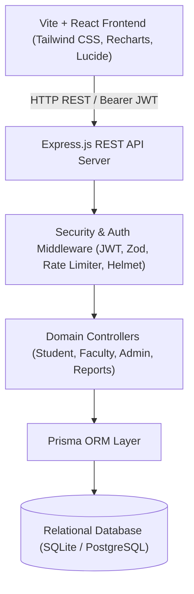
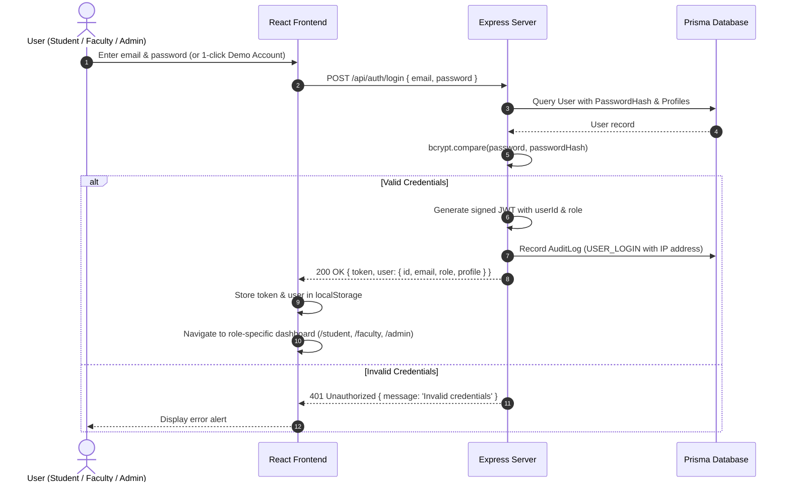
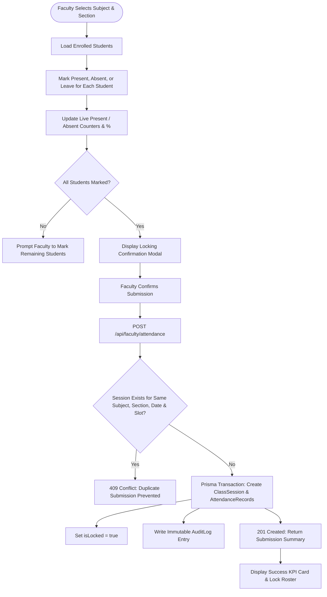

# System Architecture & Component Design

## 1. High-Level Architecture Overview

The Logisys Smart Attendance Management System employs a modular full-stack client-server architecture built for high performance, responsiveness, and academic data integrity.



---

## 2. Authentication & Authorization Flow

The application enforces role-based access control (RBAC) at both the API gateway and the UI routing layer.



---

## 3. Attendance Submission & Duplicate Prevention Flow



---

## 4. Component Directory Organization

```
ui/
├── src/
│   ├── components/
│   │   └── common/
│   │       ├── Badge.jsx             # Present, Absent, Leave, Status badges
│   │       ├── LoadingSkeleton.jsx   # Card & Table pulse placeholders
│   │       ├── Modal.jsx             # Accessible backdrop-blurred modal dialog
│   │       └── StatCard.jsx          # KPI metric card with trends & color accents
│   ├── context/
│   │   ├── AuthContext.jsx           # User state, JWT storage, 1-click demo switcher
│   │   └── ThemeContext.jsx          # Light / Dark theme toggler with localStorage
│   ├── layouts/
│   │   └── DashboardLayout.jsx       # Header, responsive sidebar, notifications popover
│   ├── pages/
│   │   ├── auth/
│   │   │   └── LoginPage.jsx         # Sign in & 1-click demo accounts
│   │   ├── student/
│   │   │   ├── StudentDashboard.jsx  # KPI metrics, line chart, bar chart, subject table
│   │   │   ├── StudentAttendanceHistory.jsx # Date-wise filterable history & corrections
│   │   │   ├── AttendanceCalculatorPage.jsx # Formula breakdown & what-if simulator
│   │   │   ├── StudentTimetablePage.jsx     # Weekly schedule grid
│   │   │   ├── CorrectionRequestsPage.jsx   # Grievances & proof tracking
│   │   │   └── StudentProfilePage.jsx       # Profile details & password changer
│   │   ├── faculty/
│   │   │   ├── FacultyDashboard.jsx         # Assigned courses & today's schedule
│   │   │   ├── MarkAttendancePage.jsx       # Marking roster & duplicate prevention
│   │   │   ├── FacultySessionsHistory.jsx   # Past sessions & 72-hour edit window
│   │   │   └── FacultyReportsPage.jsx       # Course-level analytics & CSV export
│   │   └── admin/
│   │       ├── AdminDashboard.jsx           # Campus stats & branch comparisons
│   │       ├── AdminStudentsPage.jsx        # Student admissions & PDF statements
│   │       ├── AdminFacultyPage.jsx         # Faculty directory & course assignment
│   │       ├── AdminCorrectionsPage.jsx     # Adjudication of student correction requests
│   │       ├── AdminAuditLogsPage.jsx       # Immutable system audit trail
│   │       └── AdminSettingsPage.jsx        # Thresholds & broadcast notifications
│   ├── services/
│   │   └── api.js                    # Fetch client with Bearer auth interceptors
│   ├── utils/
│   │   └── exportUtils.js            # RFC4180 CSV export & jsPDF statement generator
│   ├── App.jsx                       # Role-protected React Router configuration
│   ├── main.jsx                      # React 18 DOM mount
│   └── index.css                     # Tailwind CSS base and utility directives
└── server/
    ├── prisma/
    │   ├── schema.prisma             # Relational data schema & constraints
    │   └── seed.js                   # 160+ sessions, 3,200+ attendance records seed
    └── src/
        ├── controllers/              # Modular business logic
        ├── middleware/               # Auth, RBAC, Zod, and error handling
        ├── routes/                   # RESTful API routing
        ├── utils/                    # Calculator formulas & JWT sign/verify
        ├── validators/               # Zod request payload validation schemas
        └── app.js                    # Express app initialization
```
