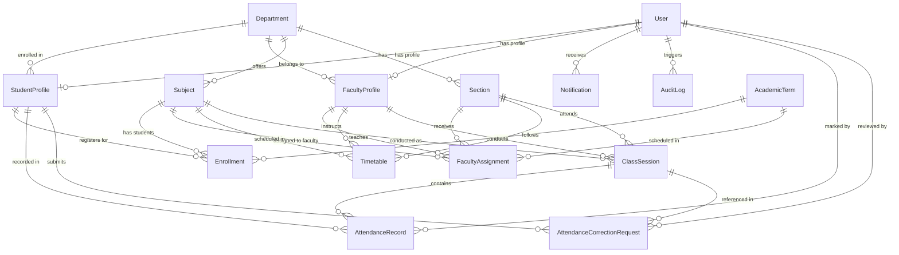

# Database Schema & Entity Relationship Specification

## 1. Entity Relationship Diagram (ERD)

---

## 2. Relational Tables & Field Definitions

### 2.1 User
| Field | Type | Attributes | Description |
|---|---|---|---|
| `id` | String (UUID) | Primary Key | Unique user identifier |
| `email` | String | Unique, Indexed | Institutional login email |
| `passwordHash` | String | Not Null | Bcrypt hashed password |
| `name` | String | Not Null | Full legal name |
| `role` | String | Default: `STUDENT` | Role: `STUDENT`, `FACULTY`, `ADMIN` |
| `avatar` | String | Nullable | Avatar image URL |
| `isActive` | Boolean | Default: `true` | Account active state |
| `createdAt` | DateTime | Default: `now()` | Timestamp |

### 2.2 StudentProfile
| Field | Type | Attributes | Description |
|---|---|---|---|
| `id` | String (UUID) | Primary Key | Profile identifier |
| `userId` | String (UUID) | Foreign Key -> `User.id`, Unique | Associated user account |
| `usn` | String | Unique, Indexed | University Seat Number (e.g., `1MS21CS089`) |
| `departmentId`| String (UUID) | Foreign Key -> `Department.id` | Department |
| `semester` | Integer | Default: `5` | Current academic semester (1–8) |
| `section` | String | Default: `'A'` | Section assignment (e.g. `'5A'`) |
| `rollNo` | String | Nullable | Class roll number |
| `contactNo` | String | Nullable | Student telephone |
| `guardianName`| String | Nullable | Parent / guardian name |
| `guardianContact`| String | Nullable | Parent telephone for emergency alerts |
| `academicBatch`| String | Nullable | Academic batch (e.g. `2023-2027`) |

### 2.3 FacultyProfile
| Field | Type | Attributes | Description |
|---|---|---|---|
| `id` | String (UUID) | Primary Key | Profile identifier |
| `userId` | String (UUID) | Foreign Key -> `User.id`, Unique | Associated user account |
| `employeeId` | String | Unique, Indexed | Staff ID (e.g., `FAC-CSE-012`) |
| `departmentId`| String (UUID) | Foreign Key -> `Department.id` | Department |
| `designation` | String | Not Null | E.g. Professor & HOD, Associate Professor |
| `qualification`| String | Nullable | Degree qualifications (Ph.D., M.Tech) |
| `contactNo` | String | Nullable | Contact number |

### 2.4 ClassSession
| Field | Type | Attributes | Description |
|---|---|---|---|
| `id` | String (UUID) | Primary Key | Session identifier |
| `subjectId` | String (UUID) | Foreign Key -> `Subject.id` | Subject taught |
| `sectionId` | String (UUID) | Foreign Key -> `Section.id` | Section attending |
| `facultyId` | String (UUID) | Foreign Key -> `FacultyProfile.id`| Teaching faculty |
| `date` | DateTime | Not Null | Session calendar date |
| `timeSlot` | String | Not Null | E.g. `09:00 - 10:00` |
| `topicCovered`| String | Nullable | Curriculum topics covered |
| `sessionType` | String | Default: `'REGULAR'` | `REGULAR`, `LAB`, `TUTORIAL`, `REMEDIAL` |
| `isLocked` | Boolean | Default: `false` | Submission lock state |
| `lockedAt` | DateTime | Nullable | Timestamp of lock |

**Unique Constraint**: `@@unique([subjectId, sectionId, date, timeSlot])`  
*Enforces strict database-level prevention of duplicate class sessions for the same subject, section, date, and hour slot.*

### 2.5 AttendanceRecord
| Field | Type | Attributes | Description |
|---|---|---|---|
| `id` | String (UUID) | Primary Key | Record identifier |
| `sessionId` | String (UUID) | Foreign Key -> `ClassSession.id` | Parent session |
| `studentId` | String (UUID) | Foreign Key -> `StudentProfile.id`| Student evaluated |
| `status` | String | Default: `'PRESENT'` | `PRESENT`, `ABSENT`, `LEAVE` |
| `remarks` | String | Nullable | Medical / OD remarks |
| `markedById` | String (UUID) | Foreign Key -> `User.id` | User who recorded mark |
| `updatedAt` | DateTime | Auto-updated | Modification timestamp |

**Unique Constraint**: `@@unique([sessionId, studentId])`  
*Guarantees a student can have at most one attendance status per class session.*

### 2.6 AttendanceCorrectionRequest
| Field | Type | Attributes | Description |
|---|---|---|---|
| `id` | String (UUID) | Primary Key | Request identifier |
| `studentId` | String (UUID) | Foreign Key -> `StudentProfile.id` | Student requesting |
| `sessionId` | String (UUID) | Foreign Key -> `ClassSession.id` | Session in question |
| `currentStatus`| String | Not Null | Status recorded (`ABSENT`) |
| `requestedStatus`| String | Not Null | Requested status (`PRESENT` or `LEAVE`) |
| `reason` | String | Not Null (min 10 chars) | Explanation |
| `proofDocUrl` | String | Nullable | Certificate / permission document URL |
| `status` | String | Default: `'PENDING'` | `PENDING`, `APPROVED`, `REJECTED` |
| `reviewedById`| String (UUID) | Foreign Key -> `User.id` | Admin who adjudicated |
| `reviewRemarks`| String | Nullable | Admin notes |

### 2.7 AuditLog
| Field | Type | Attributes | Description |
|---|---|---|---|
| `id` | String (UUID) | Primary Key | Log identifier |
| `userId` | String (UUID) | Foreign Key -> `User.id`, Nullable | Actor responsible |
| `action` | String | Not Null | Action type code |
| `entity` | String | Not Null | Target table / model |
| `entityId` | String | Nullable | Target record ID |
| `details` | String | Not Null | Human-readable log details |
| `ipAddress` | String | Nullable | Client IP address |
| `createdAt` | DateTime | Default: `now()` | Immutable timestamp |

### 2.8 SystemSetting
| Field | Type | Attributes | Description |
|---|---|---|---|
| `id` | String (UUID) | Primary Key | Setting identifier |
| `key` | String | Unique | Setting key name |
| `value` | String | Not Null | Config value |
| `description` | String | Nullable | Setting explanation |
